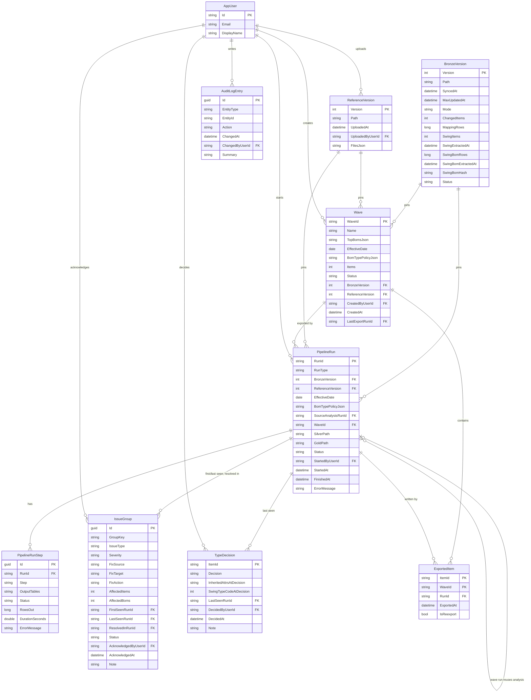
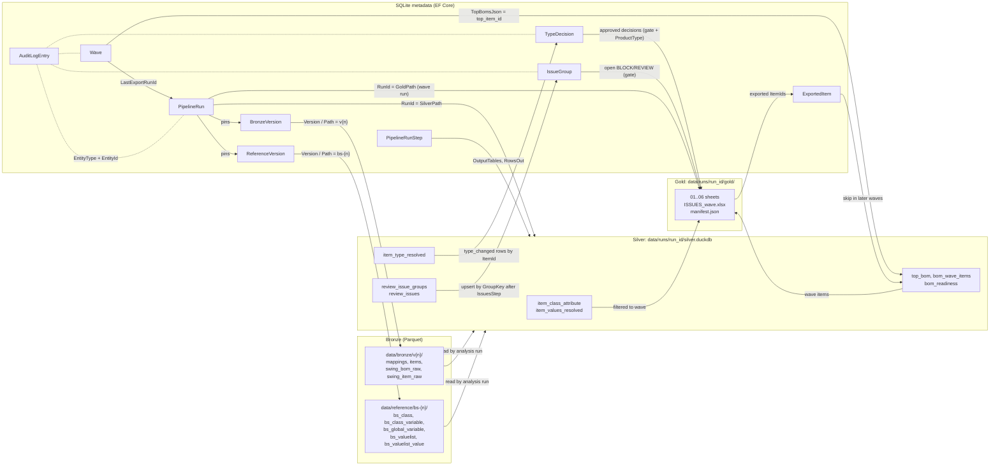
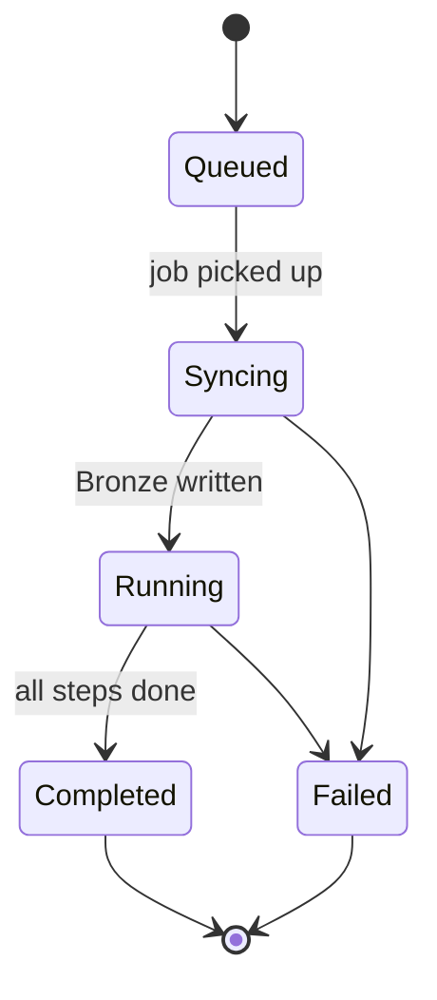
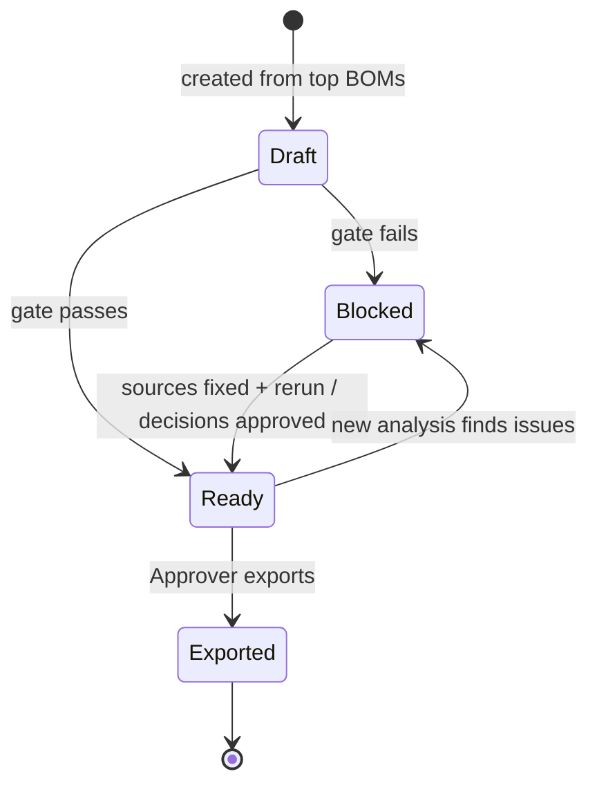
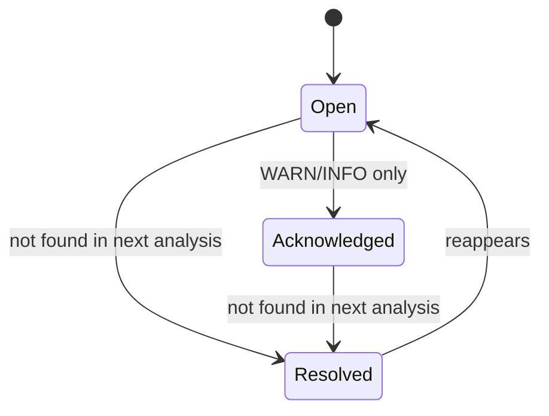
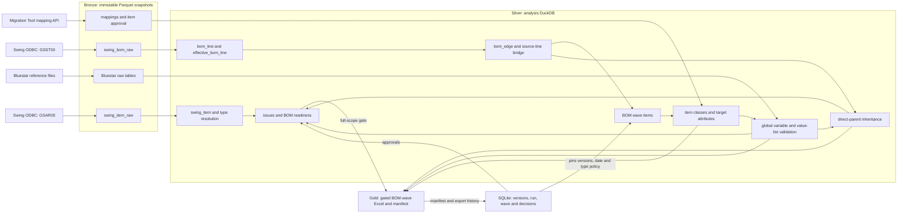

# MD Pipeline – Architecture & Agent Guide

> **Purpose:** Standalone app that turns mapped Swing master data into Bluestar PLM import sheets.
> It reads the **Migration Tool** (REST, read-only), **Swing item master (`GSAR00`) and authoritative BOM (`GSST00`)** (ODBC, read-only) and the **Bluestar reference files**, builds **one class per migrated item**, assigns existing **global variables + value lists**, highlights what needs review, and exports per **BOM wave**.
> Functional baseline: `doc/requirements/masterdata_pipeline_app_spec_v10.md`. This revision supersedes conflicting BOM-source statements in that baseline.
> Confirmed: `GSST00.STANR` is the parent item ID and joins to `GSAR00.ARANR`; `GSAR00.ARVAKZ`: `2 = CONFIGURABLE`, `0 = FIXED`.
> Toolstack and conventions follow the Classification Tool (`architecture.md`, `CLAUDE.md`).

---

## 1. Project Overview

- .NET 10 Minimal API backend, React + Mantine + TypeScript frontend (Vite), monorepo under `src/`.
- SQLite via EF Core for **app metadata** (runs, waves, issues, decisions, audit).
- DuckDB (via `DuckDB.NET.Data`) over Parquet for the **Bronze / Silver / Gold** data layers (millions of mapping rows; set-based SQL).
- Read-only integrations: Migration Tool REST (`HttpClient`), Swing ODBC (`System.Data.Odbc`).
- ~20,000 items, internal users only.
- Roles: **Viewer**, **Analyst**, **Approver**, **Admin**.

| Role | Can |
|---|---|
| Viewer | Read overview, item classes, issues, BOM readiness, download exports |
| Analyst | Viewer + start sync/analysis runs, acknowledge WARN/INFO issues, create waves |
| Approver | Analyst + approve/reject fixed → configurable type changes, export waves |
| Admin | Approver + upload Bluestar reference versions, full resync, users and settings |

### Non-negotiable principles
1. **Read-only** towards Migration Tool and Swing. No writes, ever.
2. **No suggestions or predictions.** The review layer states what is wrong, where, and which source to fix.
3. **One class per migrated item** (`CL_<item_id>`). Global variables, value lists and values are **reused, never created**.
4. **Wave = BOM.** One or more top-level BOMs exploded to all levels; gate and export per wave.
5. Deterministic and rerunnable: same Bronze + Bluestar version, effective date and BOM-type policy → identical logical Silver/Gold.

---

## 2. Build & Run Commands

### Quick start (Windows)
```powershell
.\start.ps1              # restores tools, installs npm packages if needed, starts API + frontend, opens the browser
.\start.ps1 -Install     # force npm ci
.\start.ps1 -Reset       # delete local md_pipeline.db* and data\ first
.\start.ps1 -NoBrowser   # don't open the browser
```
If script execution is blocked: `powershell -ExecutionPolicy Bypass -File .\start.ps1`. Ctrl+C stops both processes.
Local secrets/overrides (e.g. `Swing__OdbcConnectionString`, `Swing__Enabled`, `Swing__Library`, `Swing__AllowedLibraries__0`) go in a git-ignored `.env` at the repo root (template: `.env.example`); `start.ps1` loads it into the API process. Shell variables override `.env`. Running `dotnet run` directly does not read `.env`.

### Database (metadata)
```bash
cd src/backend
dotnet tool restore
dotnet tool run dotnet-ef database update --project Haworth.MdPipeline.Data --startup-project Haworth.MdPipeline.Api
```

### Backend (.NET 10)
```bash
cd src/backend
dotnet build
dotnet run --project Haworth.MdPipeline.Api      # http://localhost:5100
dotnet test                                        # all tests
```

### Frontend (React + Vite)
```bash
cd src/frontend
npm install
npm run dev       # http://localhost:3100 with /api proxy to backend
npm run build     # TypeScript check + Vite production build
npm run lint      # ESLint
```

### Local prerequisites
- ODBC driver + DSN for Swing (read-only user), or leave `Swing:Enabled=false` and use the fixtures in `src/backend/tests/fixtures/swing/GSST00.csv` and `GSAR00.csv`.
- Migration Tool reachable at `MigrationTool:BaseUrl` (or `MigrationTool:UseFixtures=true` to load `src/backend/tests/fixtures/mt/*.json`).
- Data folder writable: `Pipeline:DataDir` (default `./data`).
- `appsettings.Development.json` enables both fixture modes, `AutoMigrate` and `SeedIdentity` (users `admin|approver|analyst|viewer@mdpipeline.local`, password `ChangeMe123!`).

---

## 3. Requirements & Design Docs

- Before implementing or planning any feature, read `doc/requirements/masterdata_pipeline_app_spec_v10.md` and every file in `doc/requirements/`.
- Save every feature plan as markdown in `doc/requirements/plans/` (e.g. `bronze-sync.md`, `wave-export.md`). This is the only location for plans.
- **Design discussion required before writing code:**
  - Any new feature area or module
  - Adding DuckDB.NET (first use of DuckDB in the stack) – confirm package and hosting
  - Excel export library and Bluestar import template layout
  - Swing ODBC configuration (library/schema, date sentinel rules, pseudo encoding and BOM-type meanings)
  - Migration Tool bulk mapping endpoint (requested from Migration Tool team)
  - Azure AD / SSO swap

---

## 4. Architecture Decisions

- **No CQRS, no MediatR, no event sourcing** – simple service layer.
- **3-layer solution** like the Classification Tool, plus a pipeline project for the data layers:
  - `Api` – Minimal API endpoints, services, background job host.
  - `Core` – domain models, enums, interfaces, business rules (zero framework dependencies).
  - `Data` – EF Core DbContext (SQLite), Identity, migrations.
  - `Pipeline` – Bronze/Silver/Gold steps: SQL files + DuckDB executor, source clients (REST/ODBC/Excel), export writers.
- **Two stores:** SQLite (EF Core) for metadata and audit; DuckDB files + Parquet for data layers. Never put mapping-scale data in SQLite.
- **Background runs** via a single `BackgroundService` + `Channel<RunRequest>` queue (one analysis at a time; wave exports may run in parallel). No Hangfire/Quartz.
- **SQL lives in `.sql` files** (embedded resources) per step; C# only orchestrates, binds parameters and records step results.
- Auth: ASP.NET Core Identity + JWT (HS256) now, Azure AD / OIDC later via abstraction.
- Enum states stored as strings.

---

## 5. Solution Structure

```
src/
├── backend/
│   ├── Haworth.MdPipeline.Api/
│   │   ├── Endpoints/          # static extension classes: Map*Endpoints
│   │   ├── Services/           # RunService, WaveService, IssueService, TypeDecisionService, ReferenceService, ExportService
│   │   ├── Jobs/               # PipelineJobHost (BackgroundService), RunQueue (Channel)
│   │   ├── Contracts/          # DTOs (request/response records)
│   │   └── Program.cs
│   ├── Haworth.MdPipeline.Core/
│   │   ├── Domain/             # entities (metadata) + value objects
│   │   ├── Enums/
│   │   ├── Interfaces/         # IMigrationToolClient, ISwingItemReader, ISwingBomReader, IBluestarReferenceReader, IDataLayerStore, IExportWriter
│   │   └── Rules/              # pure rule helpers (status derivation, gate evaluation, type resolution)
│   ├── Haworth.MdPipeline.Data/
│   │   ├── MdPipelineDbContext.cs
│   │   ├── Identity/AppUser.cs
│   │   └── Migrations/
│   ├── Haworth.MdPipeline.Pipeline/
│   │   ├── Sources/            # MigrationToolClient (HttpClient), SwingOdbcReader (GSAR00 + GSST00), BluestarExcelReader
│   │   ├── Duck/               # DuckDbExecutor, ParquetWriter, SqlScriptLoader
│   │   ├── Steps/              # IPipelineStep implementations (one per step)
│   │   ├── Sql/                # *.sql per step (embedded)
│   │   └── Export/             # Gold → Excel, manifest.json
│   └── tests/
│       ├── Haworth.MdPipeline.Core.Tests/
│       ├── Haworth.MdPipeline.Pipeline.Tests/   # fixture-based SQL tests (A5ENIA, ASYCB3S0, value list cases)
│       └── Haworth.MdPipeline.Api.Tests/
└── frontend/
    └── src/ (see §11)
```

### Backend rules
- Endpoints call services only. Never call `DbContext`, DuckDB or source clients from endpoints.
- Services own validation, orchestration and audit entries.
- Business rules (status derivation, gate, type resolution) in `Core/Rules` – pure, unit-tested.
- Source clients are behind `Core/Interfaces`; fixtures implement the same interfaces for tests and local dev.
- Migration Tool client: `GET` only, plus `POST /auth/*` and `POST /bom/items/by-ids` (read). A test asserts no other verbs are issued.
- Swing reader: opens the ODBC connection read-only; rejects configured SQL that does not start with `SELECT`.

---

## 6. Data Sources

| # | Source | Access | Data | Refresh |
|---|---|---|---|---|
| S1 | Migration Tool | REST (`HttpClient`, Polly retry, max 5 concurrent) | Mappings, item headers and migration approval; optional BOM copy for reconciliation only | Incremental by `updatedAt` |
| S2 | Swing | ODBC (`System.Data.Odbc`), read-only account | GSAR00 item master and GSST00 BOM (parent, child, type, position, pseudo, effectivity) | Full per sync |
| S3 | Bluestar files | Upload (Admin) → stored per version | Class list, class variables, global variables, value list headers, value list values | New version per upload |

### Migration Tool endpoints used
| Data | Endpoint |
|---|---|
| Auth | `POST /auth/login` (**form fields** `username`, `password` → `access_token`; JSON gets 422), `POST /auth/refresh` |
| Item list + headers | `GET /bom/items?limit=&offset=` (bare array, stable order; ~22k items on hwds-dev). **Defines which items are imported** – never every Swing item |
| Mappings | `GET /export/workspace-mappings?updatedSince=` (requested bulk) · fallback `GET /workspace-mappings/{itemId}` for the listed items only (BOM-scoped: listed items inside the selected explosions) |
| Item headers (fallback) | `POST /bom/items/by-ids` (bare JSON array of ids) – only for bulk-mapping items missing from `/bom/items` |
| Optional BOM reconciliation | `GET /bom/hierarchy?limit=&offset=` (not authoritative) |

### Swing ODBC
- `Swing:ItemSql` reads the full GSAR00 extract (`ARANR` … `ARBDID`); item type (`ARVAKZ`) is derived in Silver. Pseudo comes separately from `GSST00.STFIST`, not from the item master.
- `Swing:BomSql` reads `GSST00`; `STANR` is the confirmed parent item ID, `STANRU` the child, `STBKAR` the BOM type and `STBKPO` the position. Full source contract and queries are in section 18.
- Confirmed `Swing:TypeCodes`: `0 = FIXED`, `2 = CONFIGURABLE`; other values remain `UNKNOWN` and raise review issues.
- `{library}` is substituted only if it is a valid identifier listed in `Swing:AllowedLibraries`; configured SQL must be a single `SELECT`.
- Unconfirmed encodings are explicit config: `Swing:PseudoFlags` (STFIST map), `Swing:OpenEndedDateIn/Out` (raw `year/month/day` patterns), `Swing:TwoDigitYearPivot`, `Swing:DateOutInclusive`.
- **Confirmed from the live GSST00 extract (2026-11-19, 1,034,531 lines):** dates are stored with **2-digit years** (`STABJJ` 13–26 → 2013–2026; pivot 79: `yy ≤ 79` → 20yy, else 19yy) and `0/0/0` means "no date" (valid from the beginning / never ends) on ~95 % of lines. Defaults: `OpenEndedDateIn/Out = ["0/0/0"]`, `TwoDigitYearPivot = 79`. Partially zero dates (e.g. `0/4/1`) remain `BOM_DATE_UNRESOLVED`.
- **STFIST (pseudo/phantom) confirmed:** only `N` (no, 989,447 lines) and `J` (German *Ja* = yes, 45,410 lines) occur. Default `PseudoFlags = { J: true, Y: true, N: false }`; any other value stays `PSEUDO_FLAG_UNKNOWN`.
- **Item type confirmed:** `ARVAKZ` is read only from the GSAR00 **base record** (`ARMONR` blank). Model rows (`ARMONR` filled) are ignored for the type. Several base rows with different `ARVAKZ` → `ITEM_MODEL_AMBIGUOUS`; no base record → `ITEM_TYPE_UNKNOWN`.
- Identifiers are trimmed only (leading zeros and case preserved, §18.5).

### Bluestar files (per version)
| File | Bronze table |
|---|---|
| Bluestar classification list.xlsx | `bs_class` |
| Bluestar classification variable name table.xlsx | `bs_class_variable` |
| Bluestar global variables.xlsx | `bs_global_variable` |
| BS Value Variable List table.xlsx | `bs_valuelist` |
| Bluestar GlobalVariableList.xlsx | `bs_valuelist_value` (**values are space-padded → TRIM**) |

Column names follow the actual Bluestar export headers (§8.1). Uploads are rejected only when a column needed by the Silver steps is missing; other absent columns are stored as NULL.

---

## 7. Business Rules (implemented in Silver SQL + `Core/Rules`)

| # | Rule |
|---|---|
| R1 | Keep only `attribute_type = 'engineering'`. |
| R2 | `new_value = 'NOT REQUIRED'` → excluded. |
| R3 | Blank target → excluded + `MAPPING_MISSING`. |
| R4 | `value_status = 'ignored'` or `legacy_reachable = FALSE` → excluded. |
| R5 | `mapped_from = 'predicted'` or `feasibility = 'Review'` → `PENDING_REVIEW`, not used until confirmed in the source. |
| R6 | `NA` is a valid value; `*` matched literally; comparisons on `TRIM`, case-sensitive. |
| R7 | One class per item: `CL_<item_id>`, parent `CL_MIGRATED_ROOT`, hidden. |
| R8 | Target attributes come from the mapping API. |
| R9 | Attribute not a non-obsolete Bluestar `VARIABLENAME` → **REVIEW** (`ATTRIBUTE_NOT_IN_BS`), kept with source `MAPPING_API`. |
| R10 | Candidates = distinct (global variable, value list, value type) for that variable name across Bluestar classes, with `class_usage`. |
| R11 | Coverage: list candidate = used values in list; free candidate = used values valid for value type. |
| R12 | Assignment: full-coverage list → full-coverage free type → highest coverage. Ties: `class_usage`, then name. |
| R13 | **GO** = full coverage; **HIGHLIGHT** = show attribute, global variable, value list, covered/used, missing values. |
| R14 | Direct-parent inheritance; needs (OWN + CONDITION) pushed to every direct parent one level at a time; inherited attribute takes the owner's global variable/list. |
| R15 | Need reaches the BOM top unowned → `INHERITED_ATTRIBUTE_MISSING_ON_TOP_ITEM`. |
| R16 | Swing `FIXED` item with any INHERITED attribute → `CONFIGURABLE`, Approver decision required. Pseudo is per BOM line and does not change item type. |
| R17 | GSST00 is authoritative for BOM structure and effectivity. Preserve BOM type, position, model and source dates; derive distinct effective parent-child edges for traversal only. Pseudo may differ per parent (valid). |

---

## 8. Data Layers (DuckDB + Parquet)

Storage:
```
data/
├── bronze/v{n}/                 # Migration Tool + Swing snapshot (versioned)
│   ├── mappings/item_bucket=XX/*.parquet
│   ├── items.parquet  swing_item_raw.parquet  swing_bom_raw.parquet
│   └── mt_bom_hierarchy.parquet  # optional reconciliation only
├── reference/bs-{n}/            # Bluestar files as Parquet (versioned)
└── runs/<run_id>/
    ├── silver.duckdb
    └── gold/  01_class.xlsx … 06_eoav_condition.xlsx  ISSUES_<wave>.xlsx  manifest.json
```

### 8.1 Bronze
| Table | Grain | Columns |
|---|---|---|
| `mappings` | item + feature + value + condition (one row per Migration Tool mapping row) | legacy_item_id (API `itemId`), legacy_feature_id, legacy_value, new_attribute_id, new_value, attribute_type, condition, simplified_legacy_condition, target_condition, formula, mapped_from, value_status, feasibility, legacy_reachable, inherited (raw text, e.g. `Yes`/`No`), prediction_status, prediction_confidence (raw text, e.g. `High`), prediction_match_type, prediction_evidence (from nested `prediction`), signed_on_by, signed_on_at, updated_at (API sends Unix seconds), raw_json (complete source object), item_bucket |
| `items` | item | item_id, description, category, product_type, priority, approved_for_migration, raw_json (incl. `features`) |
| `swing_bom_raw` | GSST00 source row | STANR, STBKAR, STBKPO, STANRU, STMNRU, STMNG, STFORM, STMEIN, STAUSF, STAUSM, STAGPO, STFIST, STABJJ, STABMM, STABTT, STBIJJ, STBIMM, STBITT, STTXLN, STBDID |
| `mt_bom_hierarchy` | optional API source row | parent_bom, item_id, level, qty, pseudo, date_in, date_out; reconciliation only |
| `swing_item_raw` | GSAR00 source row | ARANR, ARMONR, ARABZ1, ARABZ2, ARPROB, ARPROG, ARARGR, ARMEIN, ARMART, ARVAKZ, ARBDID |
| `bs_class` | class | CLASSNAME, AXITEMTEMPLATE, CLASSDESCRIPTION, CLASSNAMEMASK, DIRTY, ENABLEDFORCLASSIFICATION, EXTENSCLASSNAME, KEYWORDS, NUMSEQUENCE, PARTNUMBERPATTERN, ROOTINALTTREE, SECONDARYROOT, STDPART, SUBTYPE |
| `bs_class_variable` | class + variable | CLASSNAME, DISPLAYNAME, VARIABLENAME, ATTRIBUTEID, DEFAULTVALUE, DEFAULTVALUEINT, DEFAULTVALUEREAL, ECADATTRIBUTENAME, FIXEDDECIMAL, ISCADPARAMETER, ISCALCULATABLE, ISURL, LIFECYCLE, MANDATORY, OBSOLETE, SEQUENCE, SILICONEXPERTFIELD, TOLERANCEMINUS, TOLERANCEPLUS, UNIT, VALIDATECHILDDATA, VALUELISTID, VALUETYPE, VARIABLEVALUES |
| `bs_global_variable` | global variable | VARIABLETYPE (= global variable name), ALLOWMANUAL, EXTERNALID, UNIT, VALUELISTID, VARIABLEDATATYPE (= value type), VARIABLEVALUES |
| `bs_valuelist` | value list | VALUELISTID, BS_VARIABLELISTFILTER, DESCRIPTION, PARENTVALUELISTID, VALUETYPE |
| `bs_valuelist_value` | value list + value | VALUELISTID, VALUE, DESCRIPTION, PARTNUMBERVALUE, SORTING |

All Bronze tables carry `_bronze_version`, `_extracted_at`, `_source`.

### 8.2 Silver
| Table | Grain | Key columns |
|---|---|---|
| `bs_class_var` | class + variable | class_name, variable_name, global_variable, value_list_id, value_type, mandatory, unit |
| `bs_vl_value` | list + value | value_list_id, value_code (trimmed), description, sorting |
| `bs_gv_candidate` | variable + GV + list | variable_name, global_variable, value_list_id, value_type, unit, class_usage |
| `map_rules_excluded` | mapping row | item_id, legacy_feature, legacy_value, attribute_type, mapped_from, reason |
| `map_rules_clean` | item + feature + value | item_id, legacy_feature, legacy_value, target_attribute, target_value, condition, simplified_legacy_condition, target_condition, mapped_from, feasibility, is_discontinued, load_status |
| `item_class` | item | item_id, class_id, parent_class_id, description |
| `item_attr` | item + attribute | item_id, attribute_id, used_values, n_used, in_bs |
| `item_used_value` | item + attribute + value | item_id, attribute_id, value_code |
| `attr_gv_check` | item + attribute + candidate | item_id, attribute_id, global_variable, value_list_id, value_type, class_usage, n_used, covered |
| `attr_gv_assigned` | item + attribute | item_id, attribute_id, global_variable, value_list_id, value_type, n_used, covered, n_full_lists, status (GO/HIGHLIGHT) |
| `attr_missing_values` | item + attribute + value | item_id, attribute_id, global_variable, value_list_id, value_code |
| `swing_item` | validated item/model key | item_id, model_no, description_1, description_2, product_range, product_group, item_group, unit, material_type, variant_flag_raw, type_code, source_type, item_condition_id |
| `bom_line` | source BOM occurrence/version | bom_line_id, parent_item_id, child_item_id, bom_type, bom_position, child_model_no, quantity, quantity_formula, unit, scrap_factor, scrap_quantity, routing_position, is_pseudo_line, date_in, date_out, bom_condition_id, is_effective |
| `effective_bom_line` | effective source occurrence | effective bom_line rows, preserving position, model and provenance |
| `bom_edge` | effective parent + child | parent_item_id, child_item_id; traversal only, bridge to source lines |
| `bom_reconciliation` | comparable relationship | parent_item_id, child_item_id, in_swing, in_mt, comparison_status; optional, warning only |
| `item_need` | item + attribute + reason | item_id, attribute_id, reason (OWN/CONDITION) |
| `inheritance_link_s` | source line + attribute + owner | bom_line_id, parent_id, child_id, bom_type, bom_position, child_model_no, is_pseudo_line, date_in, date_out, attribute_id, owner_id, level |
| `top_missing` | top item + attribute | top_item_id, attribute_id, level |
| `item_type_resolved` | item | item_id, swing_type_code, source_type, has_inherited, inherited_attrs, resolved_type, type_changed, type_extracted_at |
| `item_class_attribute` | class + attribute | class_id, item_id, attribute_id, value_source (LOCAL/INHERITED), attribute_source (BLUESTAR/MAPPING_API), global_variable, value_list_id, n_used, covered, inherited_from, status (GO/HIGHLIGHT/REVIEW) |
| `item_values_resolved` | item + attribute + value | item_id, attribute_id, global_variable, value_list_id, value_code, condition, is_discontinued |
| `top_bom` | top item | top_item_id |
| `bom_wave_items` | top BOM + item | top_item_id, item_id, lvl |
| `item_readiness` | item | item_id, block_issues, review_issues, decisions, status |
| `bom_readiness` | top BOM | top_item_id, items, blocked_items, review_items, decision_items, already_exported_items, status |
| `review_issues` | occurrence | issue_type, severity, group_key, item_id, parent_item_id, legacy_feature_id, legacy_value, attribute_id, value_code, global_variable, value_list_id, detail, fix_source, fix_target, fix_action |
| `review_issue_groups` | group_key + issue_type | severity, fix_source, fix_target, fix_action, detail_rows, affected_items, affected_boms |

### 8.3 Gold (per BOM wave, written to Excel)
| Sheet | Grain | Columns |
|---|---|---|
| `01_class` | class | ClassId, Name, Description, ParentClassId, IsHidden, EnabledForClassification |
| `02_class_attribute` | class + attribute | ClassAttributeId, ClassId, VariableName, GlobalVariable, ValueListId, ValueType, Unit, ValueSource, IsMandatory, Sequence |
| `03_engineering_object` | item | ObjectId, ClassId, Description, SwingTypeCode, SourceType, ProductType, TypeChanged, TopBom |
| `04_engineering_object_attribute_value` | item + attribute + value | ObjectAttributeValueId, ObjectId, VariableName, ValueListId, ValueCode, IsActive |
| `05_inheritance_link` | parent class + child class + attribute | ParentClassId, ChildClassId, VariableName, OwnerClassId, BomLineId, BomType, BomPosition, ChildModelNo, IsPseudoLine, DateIn, DateOut |
| `06_eoav_condition` | item value (not loaded) | ObjectAttributeValueId, LegacyCondition, SimplifiedLegacyCondition, TargetCondition |
| `ISSUES_<wave>.xlsx` | – | Groups + one detail sheet per fix source |
| `manifest.json` | – | wave, top BOMs, items, bronze/bs versions, GSAR00/GSST00 extract times, effective date, BOM-type policy, source hashes, row counts, reused GVs/lists, gate results |

Gold never contains value list, value or global variable definitions.

### 8.4 Pipeline steps
| # | Step class | SQL / source | Output |
|---|---|---|---|
| 1 | `SyncMigrationToolStep` | REST | Bronze mappings, items, optional mt_bom_hierarchy |
| 2a | `SyncSwingBomStep` | ODBC GSST00 | Bronze swing_bom_raw |
| 2b | `SyncSwingItemStep` | ODBC GSAR00 | Bronze swing_item_raw |
| 2c | `NormalizeSwingStep` | `Sql/02_swing.sql` | swing_item, bom_line, effective_bom_line, bom_edge |
| 3 | `ReferenceStep` | `Sql/03_reference.sql` | bs_class_var, bs_vl_value, bs_gv_candidate |
| 4 | `MappingStep` | `Sql/04_mapping.sql` | map_rules_clean / excluded |
| 5 | `ClassAttributeStep` | `Sql/05_class_attr.sql` | item_class, item_attr, item_used_value |
| 6 | `GlobalVariableStep` | `Sql/06_gv_valuelist.sql` | attr_gv_check / assigned / missing |
| 7 | `InheritanceStep` | `Sql/07_inheritance_*.sql` (level loop in C#) | inheritance_link_s, top_missing |
| 8 | `ItemTypeStep` | `Sql/08_item_type.sql` | item_type_resolved |
| 9 | `FinalModelStep` | `Sql/09_final.sql` | item_class_attribute, item_values_resolved |
| 10 | `BomStep` | `Sql/10_bom.sql` | top_bom, bom_wave_items |
| 11 | `IssuesStep` | `Sql/11_issues.sql` | review_issues, groups |
| 12 | `ReadinessStep` | `Sql/12_readiness.sql` | item_readiness, bom_readiness |
| W1 | `WaveGoldStep` | `Sql/w1_gold.sql` (Silver attached read-only) | Gold tables `g01`…`g06` + issues filtered to the wave |
| W2 | `WaveExportStep` | ClosedXML | One workbook per §8.3 sheet + `ISSUES_<wave>.xlsx`; runner writes `manifest.json` |

```csharp
public interface IPipelineStep
{
    string Name { get; }
    Task<StepResult> ExecuteAsync(PipelineContext ctx, CancellationToken ct);
}
public sealed record StepResult(long RowsOut, TimeSpan Duration);
```

---

## 9. Metadata Database (EF Core / SQLite)



- Restrict-delete FKs; enums stored as strings.
- `IssueGroup` is unique on (`GroupKey`, `IssueType`) and lives across runs: `FirstSeenRunId`, `LastSeenRunId`, `ResolvedInRunId` track its lifecycle.
- `TypeDecision` resets to `Pending` when `inherited_attrs` or the Swing type code changes; `LastSeenRunId` is the last analysis that still found the type change.
- `ExportedItem` key is (`ItemId`, `WaveId`); `IsReexport = true` when an item is exported again on purpose. Later waves skip items with any non-reexport row.
- `PipelineRun.SourceAnalysisRunId` is set only for `WaveExport` runs and points to the completed analysis whose Silver was reused.
- Every state change (run start/finish, decision, acknowledgement, wave create/export, reference upload) writes an immutable `AuditLogEntry` from the owning service.

### 9.1 Connection between metadata and data layers

SQLite and the DuckDB/Parquet layers are linked by **keys and paths, not database foreign keys**. SQLite is the control plane (versions, runs, decisions, exports); Bronze/Silver/Gold hold the data.



| Metadata entity | Connects to | Linking key | Written when | Purpose |
|---|---|---|---|---|
| `BronzeVersion` | `data/bronze/v{n}/` | `Version`, `Path`; `_bronze_version` column in every Bronze table | Sync step, after files are written | Which Migration Tool + Swing snapshot exists |
| `ReferenceVersion` | `data/reference/bs-{n}/` | `Version`, `Path` | Bluestar upload, after files are written | Which Bluestar file set exists |
| `PipelineRun` (Analysis) | `data/runs/<run_id>/silver.duckdb` | `RunId` = folder; `SilverPath`; pins `BronzeVersion`, `ReferenceVersion` | Run start (Queued) → Completed | Reproducible run: same versions → same output |
| `PipelineRun` (WaveExport) | `data/runs/<run_id>/gold/` + source analysis Silver | `GoldPath`; `SourceAnalysisRunId` | Wave export start → Completed | Which analysis Silver was reused, where the files are |
| `PipelineRunStep` | Silver tables produced by the step | `RunId` + `Step`; `OutputTables` | After each step | Run timeline, row counts, errors |
| `IssueGroup` | `review_issue_groups` (detail stays in `review_issues`) | `GroupKey` + `IssueType` | After `IssuesStep` (upsert) | Issue status across runs; detail rows queried from the run's Silver |
| `TypeDecision` | `item_type_resolved` | `ItemId`; compared on `InheritedAttrsAtDecision`, `SwingTypeCodeAtDecision` | Created/reset after `ItemTypeStep`; decided by Approver | Fixed → configurable approval used by gate and `ProductType` |
| `Wave` | `top_bom`, `bom_wave_items`, `bom_readiness` | `TopBomsJson` (top_item_id list) | Wave created by Analyst | Defines the BOM explosion and gate scope |
| `Wave.LastExportRunId` | `data/runs/<run_id>/gold/` | `RunId` | Successful export | Locate the exported files |
| `ExportedItem` | Gold `03_engineering_object`; next wave's `bom_readiness.already_exported_items` | `ItemId` + `WaveId` | Same transaction as export completion | Shared items exported once, referenced later |
| `AuditLogEntry` | Any entity above | `EntityType` + `EntityId` | By the owning service | Immutable who-did-what |

### 9.2 Lifecycle of the links

**Analysis run**
1. `RunService` creates `PipelineRun` (`Queued`, `RunType = Analysis`).
2. `SyncSwingBomStep` + `SyncSwingItemStep` + `SyncMigrationToolStep` write `data/bronze/v{n}/` → insert `BronzeVersion`.
3. Run pins `BronzeVersion` + latest `ReferenceVersion`; `SilverPath = data/runs/<run_id>/silver.duckdb`.
4. Steps 3–12 write Silver tables; each step inserts a `PipelineRunStep` with `OutputTables` and `RowsOut`.
5. `IssuesStep` upserts `IssueGroup` by (`GroupKey`, `IssueType`): found → `LastSeenRunId = run`; new → `Open`, `FirstSeenRunId = run`; not found → `Resolved`, `ResolvedInRunId = run`.
6. `ItemTypeStep` syncs `TypeDecision`: new type change → `Pending`; changed inherited attrs or Swing code → reset to `Pending`; still present → `LastSeenRunId = run`.
7. Run → `Completed`.

**Wave export**
1. `WaveService` loads `Wave.TopBomsJson` and the latest completed analysis (`SourceAnalysisRunId`), matching the wave's pinned versions.
2. Validation scope = the complete effective Swing BOM explosion. Emission scope = validation scope minus unchanged previously exported items (unless re-export). Previously exported shared items remain in gate validation.
3. Gate (`Core/Rules/WaveGate`): open `IssueGroup` with BLOCK/REVIEW detail on wave items (queried from the source Silver), `TypeDecision` approvals, known item types, references in the pinned `ReferenceVersion`, source unchanged.
4. New `PipelineRun` (`RunType = WaveExport`, `GoldPath = data/runs/<run_id>/gold/`); `WaveGoldStep` + `WaveExportStep` write Gold and `manifest.json`.
5. One SQLite transaction: insert `ExportedItem` rows, set `Wave.LastExportRunId` and `Status = Exported`, write `AuditLogEntry`.

### 9.3 Integrity checks (cross-store, enforced in services)
SQLite cannot enforce FKs into DuckDB/Parquet, so services check them:
- `RunService`: pinned `BronzeVersion.Path` and `ReferenceVersion.Path` exist before a run starts; mark the run `Failed` otherwise.
- `RunService`: on startup, runs in `Running` whose `SilverPath` is missing → `Failed`.
- `WaveService`: source analysis is `Completed` and its `SilverPath` exists; `LastExportRunId` has `gold/manifest.json`.
- `IssueService`: detail queries always use the `SilverPath` of `IssueGroup.LastSeenRunId`.
- Housekeeping: deleting a run folder is only allowed for runs not referenced by `Wave.LastExportRunId`, `ExportedItem.RunId`, `PipelineRun.SourceAnalysisRunId`, `IssueGroup.*RunId` or `TypeDecision.LastSeenRunId`.

### Enums (Core/Enums)
`RunType {Analysis, WaveExport}` · `RunStatus {Queued, Syncing, Running, Completed, Failed}` · `WaveStatus {Draft, Blocked, Ready, Exported}` · `Severity {Block, Review, Approve, Warn, Info}` · `IssueStatus {Open, Resolved, Acknowledged}` · `AttributeStatus {Go, Highlight, Review}` · `TypeDecisionStatus {Pending, Approved, Rejected}` · `FixSource {MtWorkspaceMapping, MtMigrationApproval, BluestarClassVariable, BluestarValueList, SwingItemMaster, SwingBom, MdPipelineDecision, Rerun}`

---

## 10. API Contracts (Minimal APIs in `/Endpoints`)

| Method | Path | Role | Purpose |
|---|---|---|---|
| POST | `/api/auth/login` | – | JWT |
| GET | `/api/overview` | Viewer | Totals, BOM readiness counts, top issue groups, last sync |
| POST | `/api/sync` | Analyst | Queue Migration Tool + Swing sync (`?full=true` Admin) |
| GET | `/api/swing/source` | Admin | Swing source (ODBC DSN or fixtures, library – never credentials), latest snapshot, active/last import |
| POST | `/api/swing/test-connection` | Admin | Open the Swing ODBC connection (or check fixtures) |
| POST | `/api/swing/import` | Admin | On-demand Swing-only import (full GSST00 + GSAR00) + analysis; Migration Tool Bronze carried forward from the previous snapshot (`BronzeVersion.MtCarriedFromVersion`). 409 while another import is queued/running |
| GET | `/api/migration-tool/source` | Admin | Migration Tool source (base URL, user – never the password, bulk endpoint), latest snapshot, active/last import |
| POST | `/api/migration-tool/test-connection` | Admin | Log in to the Migration Tool (or check fixtures) |
| POST | `/api/migration-tool/import` | Admin | On-demand Migration Tool-only import (`?full=true` for a full re-import, otherwise changes since the last snapshot) + analysis; Swing Bronze carried forward (`BronzeVersion.SwingCarriedFromVersion`). Body may contain `topBoms` to limit the import to those BOMs' explosions (selected items + all descendants over every GSST00 line); only those items' mappings/headers are replaced, all others are kept from the previous snapshot (`BronzeVersion.MtScopeTopBomsJson`, `MtScopeItems`). Without `topBoms` and without a bulk endpoint the request is rejected (would be one call per Swing item). 400 if no snapshot with Swing data exists or a top BOM is unknown, 409 while another import is queued/running |
| GET | `/api/boms?q=&topOnly=&limit=&offset=` | Viewer | Selectable BOMs (GSST00 parents) from the latest analysis: item, description, child/line counts, is-top |
| POST | `/api/boms/scope-preview` | Viewer | `{ topBoms }` → number of selected BOMs, size of their explosion, unknown ids |
| GET | `/api/sync/versions` | Viewer | Bronze versions |
| POST | `/api/runs/analysis` | Analyst | Queue analysis run |
| GET | `/api/runs` · `/api/runs/{runId}` | Viewer | Runs + steps |
| GET | `/api/items/{itemId}/class` | Viewer | Class model: attributes, source, GV, list, coverage, status |
| GET | `/api/items/{itemId}/class/{attributeId}/missing-values` | Viewer | Missing values for HIGHLIGHT |
| GET | `/api/items/{itemId}/type` | Viewer | Swing code, source/resolved type, inherited attrs, decision |
| GET | `/api/issues/summary` | Viewer | Open (not resolved) groups and items per fix source + severity (tab counts) |
| GET | `/api/issues/groups` | Viewer | Paged; filters severity, fixSource, issueType, status (default: not resolved), q, bom; ordered Block → Info |
| GET | `/api/issues/groups/{id}` · `/api/issues/groups/{id}/items` | Viewer | Group + paged occurrences from the Silver of the run that last saw it (`id` = IssueGroup Guid; group keys contain `|`) |
| POST | `/api/issues/groups/{id}/acknowledge` | Analyst | WARN/INFO only (400 for BLOCK/REVIEW/APPROVE), body `{ note }` |
| GET | `/api/type-changes?q=&decision=` | Viewer | Paged FIXED → CONFIGURABLE items of the latest analysis with their SQLite decision |
| POST | `/api/type-changes/decide` | Approver | `{ itemIds, decision: Approved\|Rejected, note }` (note required to reject); stored against current inherited attrs + Swing code |
| GET | `/api/boms/readiness?q=&status=` · `/api/boms/{topItemId}/tree` | Viewer | Paged top BOM readiness · explosion nodes (max 5,000) + edges |
| GET | `/api/boms/{itemId}/lines` | Viewer | Direct GSST00 lines of a parent with line provenance (latest completed analysis) |
| POST | `/api/waves` · GET `/api/waves` · GET `/api/waves/{waveId}` | Analyst / Viewer | Waves; created from top BOMs of the latest analysis, pinned to its Bronze + reference version |
| POST | `/api/waves/{waveId}/refresh` | Analyst | Re-pin the wave to the latest analysis (after a new snapshot / reference) and recount items |
| GET | `/api/waves/{waveId}/gate` | Viewer | Gate details (also sets Draft/Blocked/Ready) |
| POST | `/api/waves/{waveId}/export` | Approver | 202 + WaveExport run; 409 if gate fails or an export of the wave is running |
| GET | `/api/waves/{waveId}/files` · `/api/waves/{waveId}/files/{file}` | Viewer | Files of the last export · download (only listed names) |
| POST | `/api/reference/bluestar` | Admin | Upload 5 files → new version |
| GET | `/api/reference/bluestar/versions` | Viewer | Versions + row counts |
| GET | `/api/health` | – | Migration Tool + ODBC + data dir |

All list endpoints return `PagedResult<T>(Items, Total, Limit, Offset)`, max limit 500.

### Example DTOs
**Item class (GET `/api/items/ASYCB3S0/class`)**
```json
{
  "itemId": "ASYCB3S0",
  "classId": "CL_ASYCB3S0",
  "parentClassId": "CL_MIGRATED_ROOT",
  "itemStatus": "Review",
  "counts": { "go": 11, "highlight": 2, "review": 7 },
  "attributes": [
    { "attributeId": "ColorLevel3", "valueSource": "Local", "attributeSource": "Bluestar",
      "globalVariable": "Global_Color", "valueListId": "Global_Color", "valueListSize": 1373,
      "nUsed": 243, "covered": 240, "status": "Highlight", "inheritedFrom": null, "note": null },
    { "attributeId": "LevelCombination", "valueSource": "Local", "attributeSource": "MappingApi",
      "globalVariable": null, "valueListId": null, "valueListSize": null,
      "nUsed": 9, "covered": null, "status": "Review", "inheritedFrom": null, "note": null }
  ]
}
```

**Issue group (GET `/api/issues/groups`)**
```json
{
  "items": [
    { "groupKey": "ASYCB3S0|ColorLevel3|Global_Color|Global_Color", "issueType": "VALUES_NOT_IN_VALUELIST",
      "severity": "Block", "fixSource": "BluestarValueList", "fixTarget": "Global_Color",
      "fixAction": "Add missing values to Global_Color, or correct target values in the Workspace mapping",
      "affectedItems": 1, "affectedBoms": 1, "firstSeenRunId": "A-20261118-0200", "status": "Open" }
  ],
  "total": 1, "limit": 50, "offset": 0
}
```

**Create wave (POST `/api/waves`)**
```json
{ "name": "Tables wave 1", "topBoms": ["A5TBL01"] }
```

**Wave gate (GET `/api/waves/W-02/gate`)**
```json
{ "waveId": "W-02", "items": 1210, "alreadyExportedReferenced": 84,
  "checks": [
    { "name": "NoBlockingOrReviewIssues", "passed": false, "count": 9 },
    { "name": "TypeChangesApproved", "passed": false, "count": 1 },
    { "name": "ItemTypesKnown", "passed": true, "count": 0 },
    { "name": "ReferencesExistInBluestar", "passed": true, "count": 0 },
    { "name": "SourceUnchanged", "passed": true, "count": 0 }
  ],
  "canExport": false }
```

---

## 11. Frontend

### Structure
```
src/
├── api/          — raw async API functions (runs.ts, items.ts, issues.ts, boms.ts, waves.ts, typeChanges.ts, reference.ts, queryKeys.ts)
├── hooks/        — TanStack Query hooks, one file per entity (useRuns, useItemClass, useIssueGroups, useBoms, useWaves, useTypeChanges, useReference)
├── components/
│   ├── ui/       — StatusBadge, StatCard, FilterChips, PagedGrid (AG Grid wrapper), ConfirmModal, EmptyState
│   ├── domain/   — AttributeCard, MissingValuesPanel, IssueGroupTable, BomTree, WaveGatePanel, TypeChangeTable, RunStepTimeline
│   └── layout/   — AppLayout, role shells
├── pages/        — OverviewPage, BomWavesPage, WaveDetailPage, ItemClassPage, IssuesPage, IssueGroupPage, TypeChangesPage, ReferencePage, RunsPage
├── context/      — AuthContext
├── theme/        — Mantine Nord theme
├── i18n/locales/en/ — common.json, pipeline.json, issues.json, errors.json, help.json
└── types/
```

### Pages
| Page | Content | Role |
|---|---|---|
| Overview | Stat cards (items, BOMs ready/decision/blocked/exported), top blocking issue groups, sync/analysis buttons | Viewer |
| BOM waves | Top BOM grid with readiness; BOM tree; select BOMs → create wave; wave list with gate status | Viewer / Analyst |
| Wave detail | Gate panel, blocking groups in the BOM, export button, files | Viewer / Approver |
| Item class | `CL_<item>` header; status filter chips (All/GO/HIGHLIGHT/REVIEW); **attribute cards** (GV, list, size, covered/used, status, note); HIGHLIGHT → missing values panel | Viewer |
| Issues | Grouped AG Grid, tabs by fix source, drill-down; acknowledge WARN/INFO | Viewer / Analyst |
| Type changes | AG Grid with bulk approve/reject | Approver |
| Reference | Bluestar versions, row counts, data-quality notes; upload | Admin |
| Runs | Sync versions, analysis runs, step timeline | Viewer |

### Conventions
- API functions in `src/api/*.ts`, plain async; query keys only from `src/api/queryKeys.ts` (e.g. `queryKeys.items.class(itemId)`, `queryKeys.issueGroups.list(filters)`, `queryKeys.waves.gate(waveId)`).
- Invalidate by entity root after mutations (`queryKeys.waves.all`, `queryKeys.typeChanges.all`, `queryKeys.overview.all`).
- Poll run status every 2 s while a run is `Queued/Syncing/Running` (`refetchInterval`).
- Mantine for all UI, AG Grid for data tables (server-side paging), TanStack Query for server state.
- Domain components never fetch; pages compose hooks and pass props.
- Status colors via theme tokens: GO / READY → `nordGreen`, HIGHLIGHT / BLOCK → `nordRed`, REVIEW → `nordFrost`, DECISION / WARN → `nordAmber`, INFO → `nordBlue`. Never hardcode hex.
- All strings via `t()`; namespaces `common`, `pipeline`, `issues`, `errors`, `help`.
- **No suggestion UI:** no candidate, score or "apply" controls anywhere.

### In-app help
Each page has a contextual help drawer (role-specific, plain language) explaining: what GO / HIGHLIGHT / REVIEW mean, where to fix each issue type, what a wave gate checks, and why a fixed item becomes configurable.

---

## 12. State Transitions

### Analysis run


### Wave


### Issue group


### Gate logic (Core/Rules/WaveGate.cs)
- No open BLOCK or REVIEW issue on any item in the BOM explosion.
- All `FIXED_TO_CONFIGURABLE` items approved (decision matches current inherited attrs and Swing code).
- All items have a known Swing type.
- Referenced GVs / lists / values exist in the pinned reference version.
- Mapping source unchanged since Bronze snapshot (`updatedAt` check); Swing BOM and item master unchanged against pinned snapshots (source markers or normalized content hashes).
- Export is all-or-nothing; on success, insert `ExportedItem` rows in one transaction.

---

## 13. Configuration

```json
{
  "ConnectionStrings": { "DefaultConnection": "Data Source=md_pipeline.db" },
  "Jwt": { "Issuer": "Haworth.MdPipeline", "Audience": "Haworth.MdPipeline", "SigningKey": "development-only-change-me" },
  "MigrationTool": { "BaseUrl": "http://localhost:8000", "User": "", "Password": "", "BearerToken": "", "ProbeItemId": "__md_pipeline_probe__", "MaxConcurrency": 5, "UseBulkEndpoint": true, "UseFixtures": false },
  "Swing": {
    "Enabled": true,
    "OdbcConnectionString": "DSN=SWING;UID=md_pipeline_ro;PWD=",
    "ItemSql": "SELECT ARANR, ARMONR, ARABZ1, ARABZ2, ARPROB, ARPROG, ARARGR, ARMEIN, ARMART, ARVAKZ, ARBDID FROM {library}.GSAR00",
    "BomSql": "SELECT STANR, STBKAR, STBKPO, STANRU, STMNRU, STMNG, STFORM, STMEIN, STAUSF, STAUSM, STAGPO, STFIST, STABJJ, STABMM, STABTT, STBIJJ, STBIMM, STBITT, STTXLN, STBDID FROM {library}.GSST00",
    "Library": "CONFIGURE_LIBRARY",
    "AllowedLibraries": [],
    "TypeCodes": { "0": "FIXED", "2": "CONFIGURABLE" },
    "PseudoFlags": { "J": true, "Y": true, "N": false },
    "OpenEndedDateIn": [ "0/0/0" ],
    "OpenEndedDateOut": [ "0/0/0" ],
    "TwoDigitYearPivot": 79,
    "DateOutInclusive": true
  },
  "Pipeline": { "DataDir": "data", "FixturesDir": "../tests/fixtures", "DuckDbMemoryLimit": "8GB", "DuckDbThreads": 8, "MappingBuckets": 64, "MaxBomDepth": 100, "AnalysisCron": "0 2 * * *" },
  "AutoMigrate": false,
  "SeedIdentity": true,
  "AllowedOrigins": [ "http://localhost:3100" ]
}
```
Secrets (Migration Tool password or bearer token, ODBC password, JWT key) via environment variables / `.env` in non-dev environments. When `MigrationTool:BearerToken` is set, the client sends it as `Authorization: Bearer …` on every request and never calls `/auth/login`; a 401/403 fails the run with a "token rejected/expired" message (no retry). Test connection probes `GET /workspace-mappings/{ProbeItemId}` (200 or 404 = token accepted); the Migration Tool page shows the token's `exp` claim, never the token.

---

## 14. Testing

| Project | Focus |
|---|---|
| Core.Tests | Status derivation, gate rules, type resolution, decision reset |
| Pipeline.Tests | Fixture-driven SQL tests per step (DuckDB in-memory) |
| Api.Tests | Endpoint auth/roles, paging, 409 gate, read-only client verbs |

Required fixtures and assertions:
- **ASYCB3S0** mapping (2,470 rows): 827 clean, 1,643 excluded; 7 REVIEW attributes (`LevelCombination`, `FabricWidth*`, `OrientationOfFabricLevel*`).
- **Trim:** padded `"   F3468002"` matches `F3468002`; `NA` found in `Global_Color`.
- **Candidates:** `ColorOfFabric` → Global_UpholsteredColors / Global_MeshColors / Global_FeltColors; full list beats free type.
- **A5ENIA inheritance:** 3 direct links; A34009801 FIXED → CONFIGURABLE; Brand not propagated; missing BackFabric on A5XXXX → `INHERITED_ATTRIBUTE_MISSING_ON_TOP_ITEM`.
- **Pseudo:** item pseudo under one parent only → no issue; `IsPseudoLine` per link.
- **Swing:** item missing from ODBC extract → `ITEM_TYPE_UNKNOWN`; non-SELECT config SQL rejected.
- **Waves:** shared component exported in wave 1 is referenced, not re-exported, in wave 2; gate only considers the BOM explosion.
- **Determinism:** same versions, effective date, BOM-type policy and rules version → identical logical Gold rows (Excel binary metadata may differ).

---

## 15. Deployment

Deployable units: API (`dotnet publish Haworth.MdPipeline.Api -c Release`), frontend (`src/frontend/dist`), SQLite metadata file, `data/` folder (Parquet + DuckDB, needs fast local disk, several GB).

Checklist:
- ODBC driver + DSN on the API host; network access to Swing and the Migration Tool.
- Replace JWT key, disable `SeedIdentity`, restrict `AllowedHosts` and `AllowedOrigins`.
- Back up `md_pipeline.db` before migrations; `data/bronze` and `data/reference` are reproducible but slow to rebuild – back up as well.
- Smoke test: `/api/health` green for Migration Tool, ODBC and data dir; run a sync on a small scope; open an item class; create a draft wave.

---

## 16. Do Not
- Do not write to the Migration Tool or Swing.
- Do not suggest, predict or auto-apply mappings, attributes or values.
- Create only the migrated `CL_<item>` classes under `CL_MIGRATED_ROOT`; do not create or modify other reference classes, value lists, values or global variables.
- Do not store mapping-scale data in SQLite; use the DuckDB/Parquet layers.
- Do not put SQL inline in C#; use `Pipeline/Sql/*.sql`.
- Do not add CQRS, MediatR or event sourcing.
- Do not call DbContext, DuckDB or source clients from endpoints.
- Do not use inline query key strings; use `queryKeys.ts`.
- Do not hardcode strings or Nord hex values in components.
- Do not fetch data inside domain components.

---

## 17. Open Decisions
- ~~DuckDB.NET adoption~~ – decided: `DuckDB.NET.Data.Full` (in-process, one Silver DuckDB per run). See `doc/requirements/plans/foundation-bronze-swing.md`.
- ~~Excel library~~ – decided: ClosedXML; one workbook per §8.3 sheet (`01_class.xlsx` … `06_eoav_condition.xlsx`) + `ISSUES_<wave>.xlsx` + `manifest.json` under `data/exports/<wave>/<exportRunId>/`. Match to the real Bluestar import template still open.
- Retention policy for `data/runs/<run_id>/` folders (keep last N analysis runs + all export runs).
- Swing library/schema, pseudo encoding, open-ended date sentinels, BOM-type meanings, and source-key uniqueness. Confirmed fields and type codes are documented in section 18.
- ~~REVIEW attributes~~ – decided: REVIEW blocks the BOM and the gate (`Pipeline:ReviewBlocksExport = true`).
- ~~344 class variables with `VALUELISTID` but no `VARIABLEVALUES`~~ – decided: list when the class variable **or** its global variable says `VALUE_LIST` and the list has values (`Pipeline:ListRule = Either`). The class variable `VALUELISTID` holds the global variable id; the real list id comes from the global variable.
- Migration Tool bulk mapping endpoint (fallback: per-item calls).
- Migration Tool rows have no `legacyReachable` / `simplifiedLegacyCondition` / `targetCondition`: missing `legacyReachable` counts as reachable (`Pipeline:LegacyReachableNullIncluded = true`); condition needs are derived from `#FEATURE` tokens in the legacy condition (mapped via the feature's clean target attributes). Confirm with the Migration Tool team.
- `feasibility = "No"` rows are currently **not** excluded (only blank targets, `NOT REQUIRED`, non-engineering, ignored/discontinued per R1–R6). Confirm.
- Gate `SourceUnchanged` compares the wave pins with the latest analysis/snapshot/reference; it does not call the Migration Tool for a live `updatedAt` check.


---

## 18. Confirmed Swing ODBC contract and BOM-driven execution

This revision incorporates the supplied table screenshots and subsequent confirmations. It replaces earlier placeholder table/column names and the Migration Tool BOM as structural authority. The .NET 10 / EF Core SQLite / DuckDB-Parquet / React-Mantine toolstack is unchanged.

### 18.1 Confirmed relationships and type codes

- `GSST00.STANR` is the parent item number and directly corresponds to `GSAR00.ARANR`. No additional BOM-header join is required for this relationship.
- `GSST00.STANRU` is the child base item number; retain `STMNRU` as the child model number.
- `GSAR00.ARVAKZ` is the item-type/variant flag: `2 = CONFIGURABLE`, `0 = FIXED`. Preserve the raw value; normalize whitespace and parse without changing the code meaning. Other codes are UNKNOWN, never default FIXED.
- `GSST00.STFIST` is the line-level phantom/pseudo Y/N field. A component can be pseudo under one parent and not another; this is valid and creates no PSEUDO_INCONSISTENT issue.
- Source date sentinel rules and actual pseudo encodings are not yet confirmed. Do not silently interpret all zeros as open-ended dates or assume every non-Y value means false.

### 18.2 GSST00 field dictionary: authoritative BOM

| Source column | Description | Normalized Silver field | Handling |
|---|---|---|---|
| STANR | BOM number / confirmed parent item | parent_item_id | Trim, preserve leading zeros |
| STBKAR | BOM type | bom_type | Preserve code; filter only by explicit policy |
| STBKPO | BOM position number | bom_position | Preserve as source identifier, not row order |
| STANRU | Base item number | child_item_id | Trim, preserve leading zeros |
| STMNRU | Item model number | child_model_no | Retain for key validation |
| STMNG | BOM quantity | quantity | Decimal; no floating-point conversion |
| STFORM | Quantity formula | quantity_formula | Raw text; do not evaluate in this scope |
| STMEIN | UoM | unit | Trim |
| STAUSF | Scrap factor | scrap_factor | Decimal; preserve source scale |
| STAUSM | Scrap quantity | scrap_quantity | Decimal |
| STAGPO | Assigned routing position | routing_position | Traceability |
| STFIST | Phantom Y/N | pseudo_raw / is_pseudo_line | Explicit configurable conversion |
| STABJJ | Valid-from year | date_in_year_raw | Preserve before date construction |
| STABMM | Valid-from month | date_in_month_raw | Preserve before date construction |
| STABTT | Valid-from day | date_in_day_raw | Preserve before date construction |
| STBIJJ | Valid-till year | date_out_year_raw | Preserve before date construction |
| STBIMM | Valid-till month | date_out_month_raw | Preserve before date construction |
| STBITT | Valid-till day | date_out_day_raw | Preserve before date construction |
| STTXLN | Additional long text | additional_text | Preserve |
| STBDID | Condition number | bom_condition_id | Identifier only, not a parsed expression |

### 18.3 GSAR00 field dictionary: item master

| Source column | Description | Normalized Silver field |
|---|---|---|
| ARANR | Base item number | item_id |
| ARMONR | Model number | model_no |
| ARABZ1 | German description 1 | description_1 |
| ARABZ2 | German description 2 | description_2 |
| ARPROB | Product range | product_range |
| ARPROG | Product group | product_group |
| ARARGR | Item group | item_group |
| ARMEIN | UoM | unit |
| ARMART | Material type | material_type |
| ARVAKZ | Variant flag / confirmed type code | variant_flag_raw, type_code, source_type |
| ARBDID | Condition number | item_condition_id |

Retain both description fields; do not relabel the German descriptions as English. Migration Tool approval remains authoritative for `approved_for_migration`. Do not infer migration approval from the item-master flags.

### 18.4 Extraction SQL templates

Library/schema is deployment configuration, not supplied in the screenshots. Validate it as an identifier against an allowlist; do not interpolate arbitrary user input. Bind item filters using ODBC positional parameters. These queries are templates, not live-tested SQL.

Full BOM extract:

```sql
SELECT
    STANR, STBKAR, STBKPO, STANRU, STMNRU,
    STMNG, STFORM, STMEIN, STAUSF, STAUSM, STAGPO,
    STFIST, STABJJ, STABMM, STABTT, STBIJJ, STBIMM, STBITT,
    STTXLN, STBDID
FROM {library}.GSST00
```

Full item extract:

```sql
SELECT
    ARANR, ARMONR, ARABZ1, ARABZ2, ARPROB, ARPROG,
    ARARGR, ARMEIN, ARMART, ARVAKZ, ARBDID
FROM {library}.GSAR00
```

Compatibility item-type projection (if the existing reader interface is retained):

```sql
SELECT ARANR AS item_id, ARMONR AS model_no, ARVAKZ AS type_code
FROM {library}.GSAR00
```

Prefer the full item extract and derive item types in Silver. Do not invent an item `status` column: none was identified in the supplied GSAR00 fields. `STBDID` and `ARBDID` are condition references, not replacements for raw mapping API condition expressions.

### 18.5 Normalization, effectivity and keys

1. Bronze stores raw source columns plus `_source_table`, `_extracted_at`, `_bronze_version`, `_row_hash`. Keep date components and raw flag values unchanged.
2. Silver trims identifiers and list values, preserving leading zeros. Match item IDs consistently across GSAR00, GSST00 and the mapping API. No case folding unless the source contract permits it.
3. Construct `date_in` from STABJJ/STABMM/STABTT and `date_out` from STBIJJ/STBIMM/STBITT. Validate calendar dates. Unknown sentinel patterns or partially missing dates raise `BOM_DATE_UNRESOLVED`; never silently drop the affected relationship.
4. Provisional effectivity rule: `(date_in IS NULL OR date_in <= effective_date) AND (date_out IS NULL OR date_out >= effective_date)`. NULL is allowed only for confirmed open-ended source representations. Confirm inclusive date-out before production.
5. Normalize STFIST using an explicit map. Unknown flags raise `PSEUDO_FLAG_UNKNOWN`, not false. Different flags on different parent relationships remain valid.
6. Candidate line key: `(STANR, STBKAR, STBKPO)`. Profile uniqueness before enforcing it; effective periods and child/model fields may distinguish versions. Preserve repeated positions and occurrences. Never collapse raw rows using BOOL_OR(pseudo).
7. Check whether ARANR is unique in GSAR00. If multiple ARMONR rows have conflicting type codes or item identities, raise `ITEM_MODEL_AMBIGUOUS`; do not arbitrarily choose a row or create duplicate `CL_<item>` classes.
8. Build `bom_edge` as distinct effective parent-child pairs for graph traversal only. Keep a bridge from each edge to all effective source line IDs so position, type, pseudo and date provenance remain available.
9. BOM-type meanings are not yet confirmed. Default policy is explicitly `AllTypesUnfiltered`; preserve every code. An operator-specified filter is pinned with the run and wave.
10. Detect cycles separately. Depth limits must fail visibly rather than truncate the scope. A missing item-master record is a blocking source issue, not a reason to remove the item from the BOM.

### 18.6 Scope, inheritance and export rules

- Extract Swing BOM and item master with read-only database permissions. Record extraction windows and hashes; do not claim a single cross-source transaction with the REST mapping API.
- Pin Bronze version, Bluestar reference version, effective date and BOM-type policy. Wave reuse of analysis Silver requires all four to match.
- Select top BOMs and explode all effective descendants. Fetch mapping API data and approval for every scoped item. Structural items without approved mappings still get a class; missing API responses remain visible as issues.
- Item type is derived from GSAR00.ARVAKZ. FIXED plus inherited attributes requires CONFIGURABLE approval; pseudo alone does not change item type.
- Direct-parent inheritance uses effective graph edges and preserves GSST00 source line provenance. Inherited assignments with incompatible owner GV/list definitions require review; do not duplicate the class-attribute row or silently choose an owner.
- Full validation scope includes shared items previously exported. Emission scope may skip unchanged already-exported objects; exported does not mean confirmed imported into Bluestar. Track load confirmation separately if required.
- Gold exports new migrated classes, class attributes, items, item values and inheritance links. Global variables/value lists/values are reused, never generated. Confirm which source-provenance columns belong in actual Bluestar templates versus traceability-only sheets.
- Optional Migration Tool BOM reconciliation is warning-only. Swing remains authoritative. If the API copy lacks BOM type, compare parent-child sets and mark type comparison unavailable.
- Before export, verify mappings and Swing snapshots have not changed using source change markers or normalized hashes. Different extract timestamps alone are not evidence of stale data.

### 18.7 Updated source-to-layer connection diagram



### 18.8 Metadata, APIs and UI updates

- `BronzeVersion`: record GSAR00 row count/extract time/hash and GSST00 row count/extract time/hash. Publish a version only after required source extracts succeed.
- `PipelineRun` / `Wave`: pin `EffectiveDate`, `BomTypePolicyJson` and source analysis ID in addition to data versions.
- BOM tree APIs expose `bomLineId`, `bomType`, `bomPosition`, `childModelNo`, `isPseudoLine`, `dateIn`, `dateOut`, `quantity`, `unit` and `sourceTable = GSST00`.
- Item-type API exposes `sourceTable = GSAR00`, `sourceColumn = ARVAKZ`, raw code, normalized type, inherited attributes and decision.
- The BOM-wave page shows source, effective date, BOM-type policy and line provenance. Unknown date/pseudo encodings are visible blockers, not silently normalized defaults.
- Missing target attributes remain REVIEW; incomplete value-list coverage highlights attribute, GV, list and missing values. No mapping suggestions or write-back are introduced.

### 18.9 Required tests and remaining configuration

Tests: STANR joins ARANR; STANRU joins child ARANR with model ambiguity checks; ARVAKZ 0/2 mapping; unsupported codes stay UNKNOWN; STFIST per parent; date construction and unresolved sentinel patterns; repeated BOM positions/types; effective-date boundaries; all scoped items retained; full-scope gate on shared exports; no silent fallback to the API BOM on ODBC failure; deterministic logical outputs for pinned versions/date/policy.

Confirmed and no longer open: parent-item linkage, source table/column names shown above, and item-type codes 0/2.

Still open: deployment library/schema and ODBC driver configuration; BOM-type code meanings; actual STFIST encoding; zero/blank/max-date sentinel conventions and date-out boundary; source-key uniqueness/model behavior; exact Bluestar import-template layouts. No live ODBC connection or production extraction has been tested in this document update.
